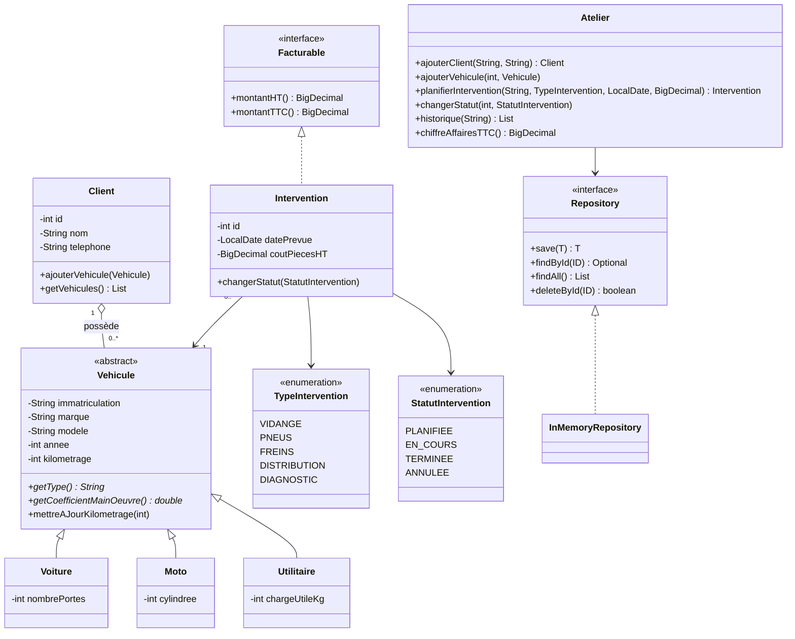
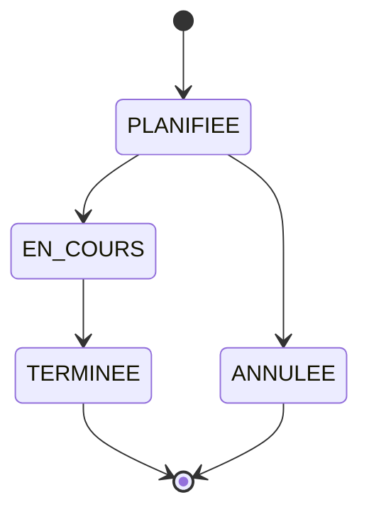

# Emaya


Application console en **Java 17** pour gérer un atelier mécanique : clients, véhicules, interventions, planning et facturation.
Projet orienté objet, sans framework, avec tests unitaires JUnit 5 et build Maven.

## Fonctionnalités

- Gestion des clients et de leurs véhicules (voitures, motos, utilitaires)
- Planification des interventions (vidange, pneus, freins, distribution, diagnostic)
- Suivi du statut : planifiée → en cours → terminée, ou annulée
- Calcul du montant HT/TTC selon le type de véhicule et le coût des pièces
- Historique par véhicule, planning du jour, chiffre d'affaires et statistiques par prestation
- Contrôles métier : format de plaque (AB-123-CD), plaque unique, kilométrage qui ne recule pas, transitions de statut autorisées

## Concepts POO mis en œuvre

| Concept | Où le voir |
|---|---|
| Encapsulation | Attributs `private`, liste des véhicules exposée en lecture seule dans `Client` |
| Abstraction | `Vehicule` est une classe abstraite |
| Héritage | `Voiture`, `Moto`, `Utilitaire` héritent de `Vehicule` |
| Polymorphisme | `getCoefficientMainOeuvre()` redéfini dans chaque sous-classe, utilisé par `Intervention.montantHT()` |
| Interface + méthode par défaut | `Facturable` avec `montantTTC()` |
| Généricité | `Repository<T, ID>` et `InMemoryRepository<T, ID>` |
| Énumérations avec comportement | `TypeIntervention` (temps forfaitaire), `StatutIntervention` (transitions) |
| Exceptions personnalisées | `RegleMetierException`, `ElementIntrouvableException` |
| Injection de dépendances | Les repositories sont passés au constructeur d'`Atelier` |
| Streams et lambdas | Historique, chiffre d'affaires, statistiques dans `Atelier` |

## Diagramme de classes (UML)



### Cycle de vie d'une intervention



## Calcul d'une facture

```
main-d'œuvre HT = 60 €/h × heures forfaitaires × coefficient du véhicule
montant HT      = main-d'œuvre + pièces
montant TTC     = montant HT × 1,20
```

Coefficients : voiture 1,0 · moto 0,8 · utilitaire 1,3 (1,5 au-delà de 1 000 kg de charge utile).
Exemple : vidange sur une voiture avec 45 € de pièces → 0,5 × 60 + 45 = 75,00 € HT, soit 90,00 € TTC.

## Structure

```
src/main/java/fr/emaya
├── App.java                  # menu console
├── DonneesDemo.java          # données fictives chargées au démarrage
├── model/                    # Vehicule, Voiture, Moto, Utilitaire, Client, Intervention, enums, Facturable
├── repository/               # Repository<T, ID> + implémentation en mémoire
├── service/                  # Atelier : règles métier
└── exception/                # exceptions métier
src/test/java/fr/emaya        # tests JUnit 5
```

## Lancer le projet

Avec Maven :

```bash
mvn test                          # lance les tests
mvn package                       # génère target/emaya-1.0.0.jar
java -jar target/emaya-1.0.0.jar  # démarre l'application
```

Sans Maven (JDK 17 ou plus) :

```bash
javac -d out $(find src/main/java -name "*.java")
java -cp out fr.emaya.App
```

Ou ouvrir le dossier dans IntelliJ IDEA et lancer `App.main()`.

## Pistes d'évolution

- Implémentation JDBC de `Repository` pour stocker les données dans PostgreSQL ou Oracle
- Export des factures en PDF
- Interface graphique JavaFX
